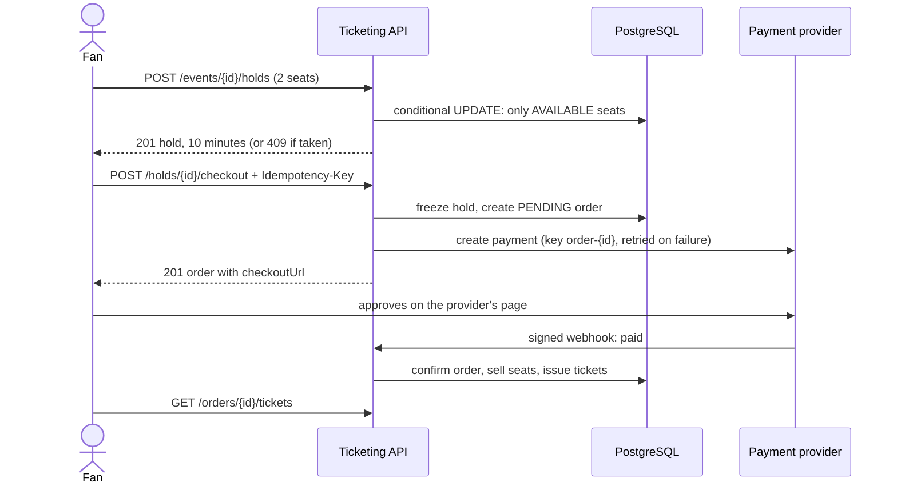
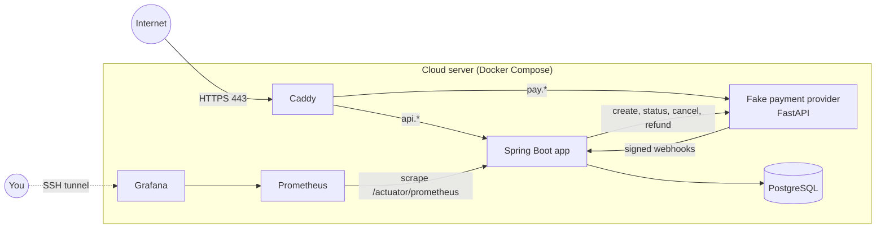

# Ticketing Backend

A ticket-sales backend built to **stay correct when thousands of fans try to buy the same seats at once**, deployed to a public server, monitored, and load-tested with measured before-and-after results.

**Java 21 · Spring Boot 4 · PostgreSQL 17 · Python/FastAPI · Docker · GitHub Actions · Gatling · Prometheus · Grafana**

## Highlights

- **No double-booking.** Seat holds use database-level concurrency control. Three strategies (conditional update, optimistic and pessimistic locking) sit behind one interface, and each is race-tested with **200 simultaneous customers** going for the same seat.
- **Realistic payments.** Checkout redirects to a payment provider I built in **FastAPI**, which reports results through **HMAC-signed webhooks**. Idempotency keys, retries with backoff, a reconciliation job and refunds for late payments make sure customers are never charged twice and never pay without getting tickets.
- **Deployed and observable.** Runs on a cloud server with Docker Compose and automatic HTTPS. Every green push to `main` deploys itself. Prometheus and Grafana show requests, latency, errors, connection-pool use, memory and CPU.
- **Measured under load.** Gatling load tests found the limit at about 25 fans per second, `EXPLAIN ANALYZE` traced it to the seat-listing queries, and **one index made the key query 65× faster and cut timeouts by 90%**. Under every overload, the data stayed consistent.

## How a purchase works



If the webhook is lost, a **reconciliation job** asks the provider every minute. If the fan abandons the payment, the job cancels it at the provider and releases the seats after a 15-minute deadline. If a payment arrives after the order has already ended, the order is marked for a **refund**, which a separate job carries out.

## Architecture



Only ports 22, 80 and 443 are open. Metrics, Prometheus and Grafana are never exposed to the internet.

## API overview

| Endpoint | Access | Purpose |
|---|---|---|
| `POST /auth/register`, `POST /auth/login` | Public | Create an account, get a one-hour JWT |
| `GET /events`, `GET /events/{id}`, `GET /venues/{id}` | Public | Browse what's on sale |
| `GET /events/{id}/seats?status=AVAILABLE` | Public | Seats, paged |
| `POST /venues`, `POST /events`, `POST /events/{id}/seats/generate` | Admin | Create venues, events and seat layouts |
| `GET /users/me` | Customer | The current user |
| `POST /events/{id}/holds` | Customer | Hold up to 6 seats for 10 minutes |
| `GET /holds/{id}`, `DELETE /holds/{id}` | Owner | View or release a hold |
| `POST /holds/{id}/checkout` | Owner | Start paying; requires an `Idempotency-Key` header |
| `GET /orders`, `GET /orders/{id}`, `GET /orders/{id}/tickets` | Owner | Orders, newest first, and their tickets |
| `POST /webhooks/payments` | Signed by the provider | Payment results |

Errors use `application/problem+json`. Someone else's hold or order returns `404`, the same as one that doesn't exist, so IDs can't be probed.

## Running it locally

**Requirements:** a Java 21 JDK and Docker.

**Option 1: everything in Docker**

```bash
docker compose --profile full up -d --build
curl http://localhost:8080/actuator/health
```

This starts PostgreSQL, the payment provider (port 8081), the app (8080), Caddy, Prometheus (9090) and Grafana (3000). The local admin is `admin@example.com` with password `local-admin-password`. Real deployments set their own secrets in a `.env` file.

**Option 2: dependencies in Docker, the app from Gradle** (for development)

```bash
docker compose up -d
ADMIN_EMAIL=admin@example.com ADMIN_PASSWORD=local-admin-password ./gradlew bootRun
```

**A quick purchase from the command line**

```bash
API=http://localhost:8080
ADMIN=$(curl -s -X POST $API/auth/login -H "Content-Type: application/json" \
  -d '{"email":"admin@example.com","password":"local-admin-password"}' | sed -E 's/.*"accessToken":"([^"]+)".*/\1/')

VENUE=$(curl -s -X POST $API/venues -H "Content-Type: application/json" -H "Authorization: Bearer $ADMIN" \
  -d '{"name":"Demo hall","city":"Nijmegen"}' | sed -E 's/.*"id":([0-9]+).*/\1/')
EVENT=$(curl -s -X POST $API/events -H "Content-Type: application/json" -H "Authorization: Bearer $ADMIN" \
  -d "{\"name\":\"Demo concert\",\"startsAt\":\"2099-10-01T20:00:00Z\",\"venueId\":$VENUE}" | sed -E 's/.*"id":([0-9]+).*/\1/')
curl -s -X POST $API/events/$EVENT/seats/generate -H "Content-Type: application/json" -H "Authorization: Bearer $ADMIN" \
  -d '{"sections":[{"name":"Floor","rows":2,"seatsPerRow":10,"priceCents":4550}]}' > /dev/null

curl -s -X POST $API/auth/register -H "Content-Type: application/json" \
  -d '{"email":"fan@example.com","password":"correct-horse-battery"}' > /dev/null
TOKEN=$(curl -s -X POST $API/auth/login -H "Content-Type: application/json" \
  -d '{"email":"fan@example.com","password":"correct-horse-battery"}' | sed -E 's/.*"accessToken":"([^"]+)".*/\1/')

SEAT=$(curl -s "$API/events/$EVENT/seats?size=1" | grep -o '"id":[0-9]*' | head -1 | cut -d: -f2)
HOLD=$(curl -s -X POST $API/events/$EVENT/holds -H "Content-Type: application/json" -H "Authorization: Bearer $TOKEN" \
  -d "{\"seatIds\":[$SEAT]}" | sed -E 's/^\{"id":([0-9]+).*/\1/')
curl -s -X POST $API/holds/$HOLD/checkout -H "Authorization: Bearer $TOKEN" -H "Idempotency-Key: demo-1"
```

The response contains a `checkoutUrl`. Open it to approve or decline the payment, then fetch `GET /orders/{id}/tickets`.

## Tests

```bash
./gradlew build                          # Java: unit and integration tests (Testcontainers, needs Docker)

cd fake-payment-provider
pip install -r requirements.txt && pytest   # Python: the payment provider
```

Integration tests run against a real PostgreSQL in Testcontainers. Some of the more interesting ones:

| Test | Proves |
|---|---|
| `HoldRaceTest` (once per strategy) | 200 customers holding one seat at the same moment: exactly one wins, no `5xx`, no half-finished holds |
| `CheckoutControllerTest` | Idempotent checkout, including 20 identical requests at the same moment creating one order |
| `PaymentWebhookTest` | Forged, tampered, old and duplicate webhooks are rejected or applied once |
| `PaymentReconciliationTest`, `…EdgeCaseTest` | Lost webhooks, abandoned payments, and a payment that becomes paid while being cancelled |
| `HttpPaymentGatewayRetryTest` | Timeouts and `5xx` are retried with the same idempotency key; `4xx` are not |
| `RefundTest`, `RefundEdgeCaseTest` | Late payments are refunded exactly once, even when the provider fails |
| `AuthorizationTest` | Deny by default; forged, expired, tampered and unsigned tokens are rejected |

CI (GitHub Actions) runs both suites on every push, and deploys only when both pass.

## Load testing

```bash
./load-tests/seed-users.sh http://localhost:8080 200 10 tokens-local.csv   # users + tokens
./gradlew -p load-tests gatlingRun --simulation ticketing.BuyerSimulation \
  -DeventId=<event-id> -DtokensFile=tokens-local.csv -DusersPerSec=2 -DdurationSeconds=60
./load-tests/check-consistency.sh <event-id>                                # must print all zeros
```

Simulated fans browse a random page of seats, hold two, retry on `409`, check out, and then approve (80%), decline (10%) or walk away (10%). Options cover stepped stress tests (`-Dsteps`, `-DstepUsersPerSec`), warm-up and an on-sale rush (`-DpickFromFirst=10`).

**Results on a 2-vCPU, 4 GB server:**

| Run | What changed | Outcome |
|---|---|---|
| Baseline, 2 fans/s | | 0 failures; most endpoints 3-10 ms inside the app |
| Stress test, up to 20 fans/s | | 0 of 24,439 failed; CPU 50% |
| Stress test, 10 → 50 fans/s | Realistic scenario | **Knee at ~25 fans/s**: the connection pool saturated first, caused by seat-listing queries without a matching index |
| Same test | Index `seats (event_id, status, id)` | First-page query **65× faster**, timeouts **−90%**, **+34%** completed requests, knee at ~30 fans/s |

Consistency checks returned zero problems after every run. Full reports, including what went wrong in the tests themselves: [`docs/load-tests/EXPERIMENTS.md`](docs/load-tests/EXPERIMENTS.md).

## Design decisions

Each major decision is written up with the options considered, the reasons, and the trade-offs accepted:

- [0001: Authentication and authorization](docs/decisions/0001-authentication.md)
- [0002: Seat holds and preventing double-booking](docs/decisions/0002-seat-holds-and-concurrency.md)
- [0003: Checkout and payments](docs/decisions/0003-checkout-and-payments.md)
- [0004: Deployment and monitoring](docs/decisions/0004-deployment-and-monitoring.md)
- [0005: Performance and load testing](docs/decisions/0005-performance-and-load-testing.md)

## Project structure

```text
src/main/java/.../ticketing_backend/
  auth/  user/          registration, login, JWTs
  event/ venue/ seat/   browsing and seat layouts
  hold/                 seat holds, the three locking strategies, expiry job
  order/                checkout, orders, tickets
  payment/              provider client, webhooks, reconciliation, refunds
  common/               paging, error handling
src/main/resources/db/migration/   Flyway migrations V1-V8
fake-payment-provider/             FastAPI payment provider with chaos settings
load-tests/                        Gatling simulations, user seeding, consistency checks
monitoring/                        Prometheus and Grafana configuration
docs/decisions/  docs/load-tests/  decision notes and load test reports
compose.yaml  Caddyfile  Dockerfile
```

## Known limitations and next steps

- **Next measurements:** CPU per container under load, and comparing the three hold strategies under an on-sale rush.
- **Next optimisations:** drop the redundant count in seat listings, keyset pagination, and the payment provider on its own server.
- **Operations:** no database backups or alerting yet; one server is a single point of failure; deploys cause a few seconds of downtime.
- **Payments:** the fake provider keeps payments in memory, so a restart forgets them. Switching to a real provider such as Mollie or Stripe means implementing one interface, `PaymentGateway`.

Each decision note ends with its own list of limitations and possible fixes.
